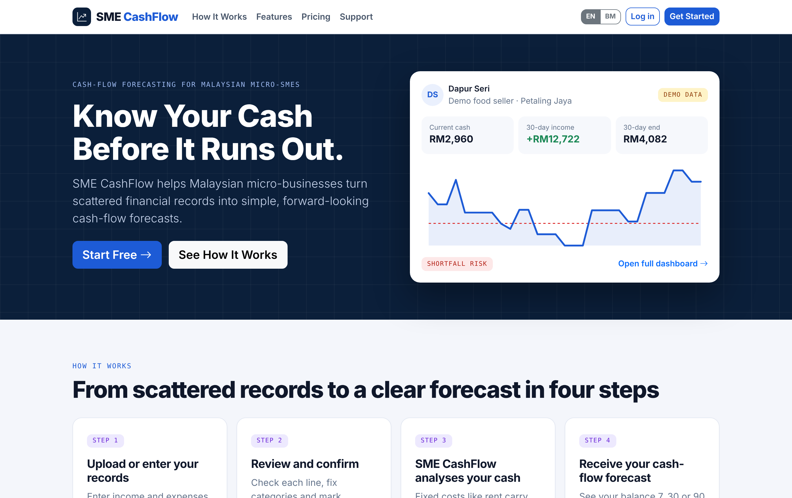
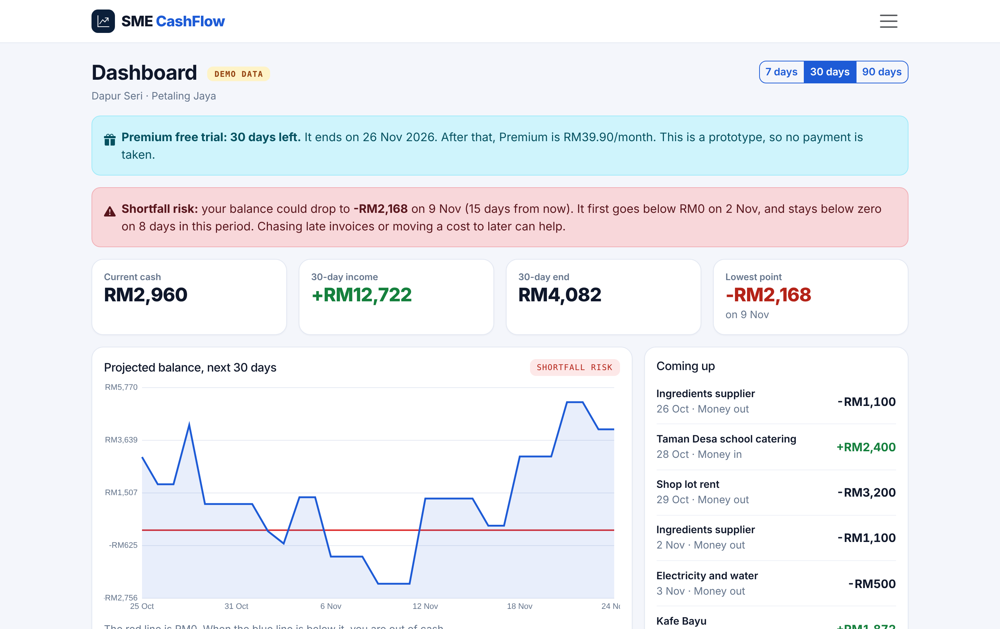
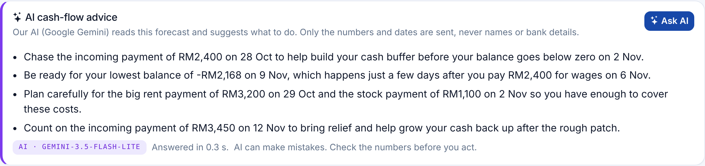
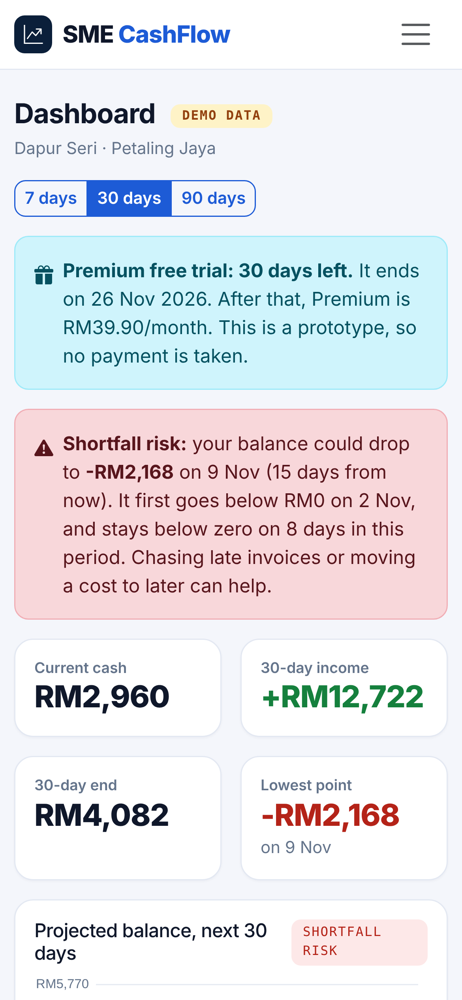
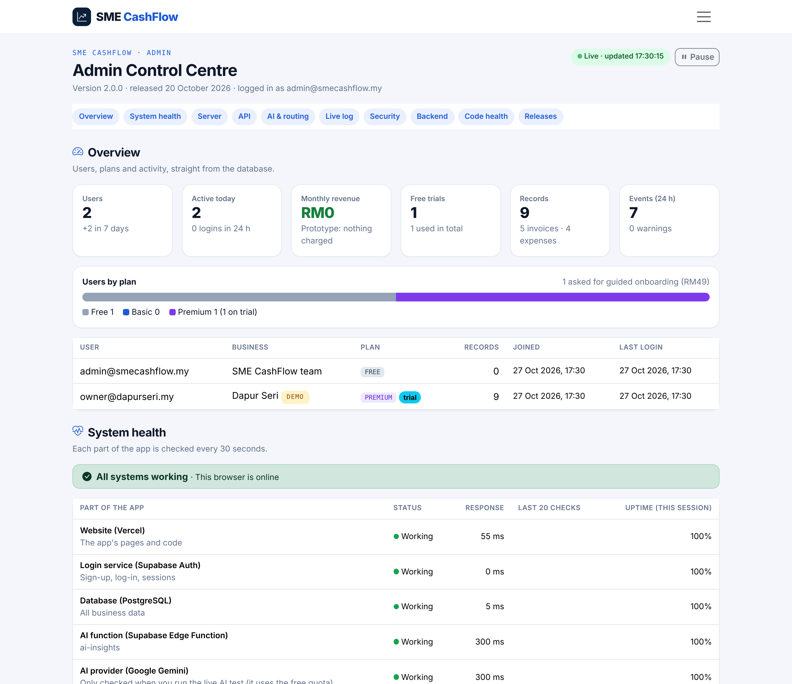
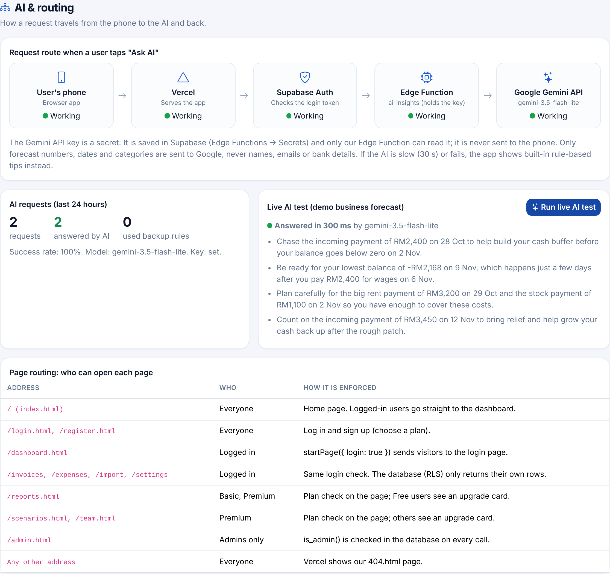
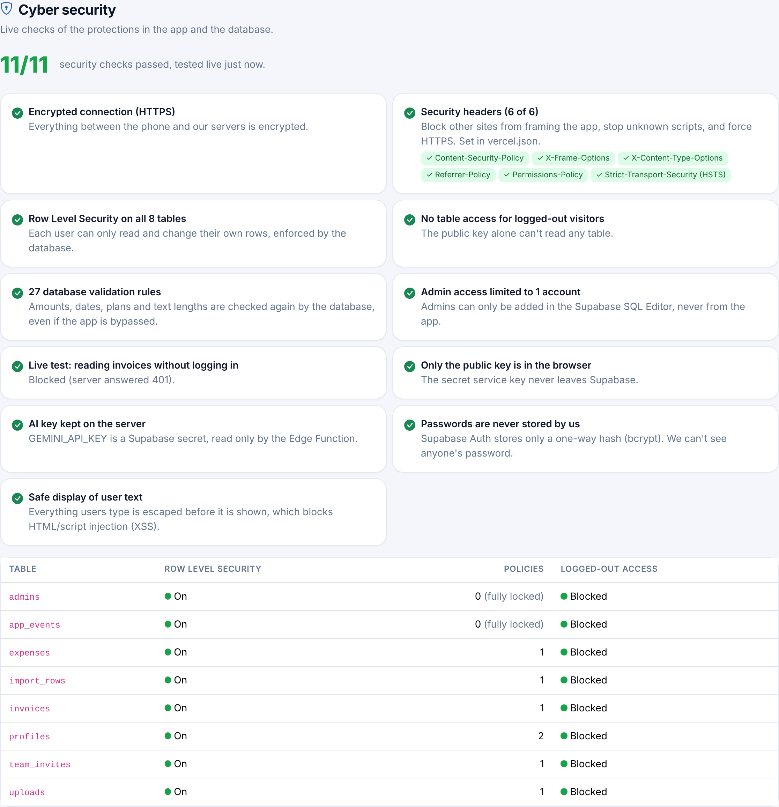
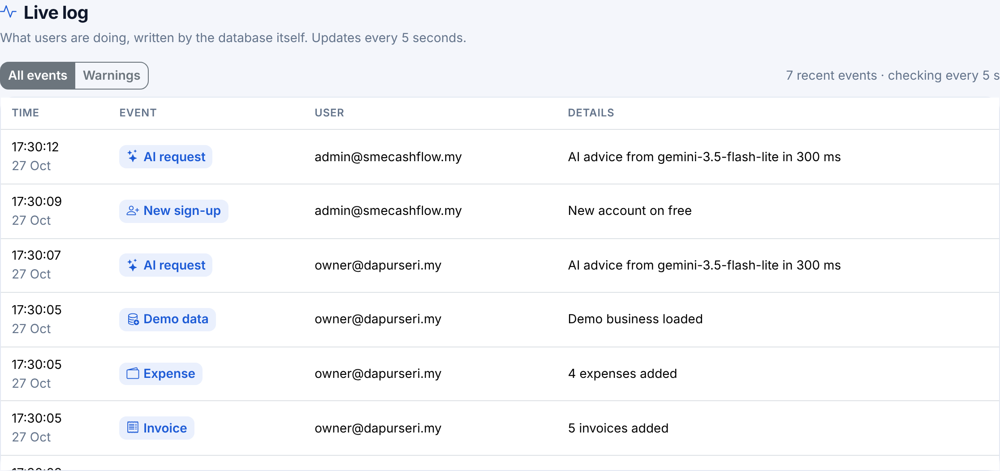

# SME CashFlow

**Know Your Cash Before It Runs Out.**
A cash-flow forecasting app for Malaysian micro-businesses (food sellers, small shops, service providers).
BFM3130 Entrepreneurship in FinTech · Tutorial 1, Group 4 · prototype, version 2.0.0 (20 Oct 2026).

**Live app:** <https://smecashflow-two.vercel.app> (opens in any browser; on a phone it can be added to the home screen and opens like an app)

### Try it in 2 minutes
1. Open the link and click **Get Started**. Sign up with any email (choose **Premium** to start the 1-month free trial).
2. Go to **Settings** and click **Load demo data** (a food seller, "Dapur Seri").
3. On the **Dashboard**, see the 30-day forecast and the shortfall warning, then click **Ask AI** for AI cash-flow tips.
4. Try **Invoices** (mark one as paid), **Scenarios** (customers pay 14 days late) and the **EN | BM** switch.

### How it is built
- **Frontend and hosting:** Vercel (free plan). Plain HTML, CSS and JavaScript, so there is no build step.
- **Backend and database:** Supabase (free plan): login, a PostgreSQL database with Row Level Security (every user only sees their own data), database functions and triggers, and one Edge Function for AI.
- **AI:** Google Gemini API (free tier), called only through our Edge Function so the API key stays secret. Only forecast numbers, dates and categories are sent. If the AI is unavailable, built-in rule-based tips are shown instead.
- **Admin Control Centre** (`/admin.html`, team admins only): users and plans, live event log, system health, server, API monitor, AI routing, security checks, backend details, automated test results and release history.
- **Quality:** 39 automated tests (open `/tests/` on the live site to run them in the browser); 11 live security checks in the Admin Control Centre.
- **Technology cost:** RM0 (Vercel, Supabase and Gemini free tiers, GitHub student account, no paid domain).

## About our app

**SME CashFlow** helps Malaysian micro-business owners see whether they will have enough cash for upcoming payments. It turns current cash, unpaid invoices and repeating expenses into a 7-, 30- or 90-day forecast, warns before a shortfall, and gives AI tips on what to do next.

| Home page | Dashboard with demo data |
|---|---|
|  |  |

| AI cash-flow advice (Google Gemini) | On a phone |
|---|---|
|  |  |

**Admin Control Centre** (team admins only)

| Overview and system health | AI & routing |
|---|---|
|  |  |

| Cyber security (11/11 live checks) | Live log |
|---|---|
|  |  |

*Screenshots use the demo business "Dapur Seri" and test accounts.*

---

## What the app does

| Feature | Plan |
|---|---|
| Cash-flow forecast with a chart and a shortfall warning: 7 days (Free), 30 days (Basic), 90 days (Premium) | All |
| Invoice tracking: add, edit, search, mark as paid (adds the money to current cash), see overdue invoices | All |
| Expense management: one-off, weekly or monthly costs, by category | All |
| Document upload: import a CSV, **review the rows first**, possible duplicates start unticked | Free: 2 a month; Basic and Premium: unlimited |
| Monthly summary report (print or save as PDF) | Basic, Premium |
| Detailed report: low point, days below RM0, top costs, costs by category, top customers, overdue invoices | Premium |
| Scenario planning: "customers pay 14 days late", "cut costs by 10%", compared with the normal forecast | Premium |
| Team access: prepare an invite code for a team member (prototype: no email is sent) | Premium |
| **1-month free trial of Premium** (once per account), then RM39.90/month | Premium |
| One-click demo business "Dapur Seri" (Petaling Jaya): RM2,960 cash, +RM12,722 income, RM4,082 at day 30, a dip to -RM2,168 | All |
| **English / Bahasa Melayu**: an **EN \| BM** switch in the menu on every page (remembered in the browser) | All |
| **8% SST** on Basic (RM21.49/month incl. SST) and Premium (RM43.09/month incl. SST), with an order summary on the sign-up page | Basic, Premium |
| **Guided onboarding** (RM49 one-time + 8% SST = RM52.92), chosen at sign-up | All |
| **AI cash-flow advice**: "Ask AI" on the dashboard gives 3-4 tips from Google Gemini, in English or BM; built-in tips if the AI is unavailable | All |
| **Admin Control Centre** for the team (see Version 2.0 below) | Admins only |

Plans: **Free RM0**, **Basic RM19.90/month** (no trial), **Premium RM39.90/month** (first month free).
This is a prototype, so no payment is ever taken and you can switch plans in Settings.

**Why the lowest point differs from our website:** the app and the website show the same current cash, 30-day income and 30-day end balance. The website's demo dashboard uses its own assumptions, mainly that customers pay sent invoices **3 days after the due date**, so its low point is -RM810. The app expects each invoice **on its due date**, so its low point is -RM2,168. To see the effect of late payments in the app, use **Scenarios** (Premium) and set "Customers pay late by".

---

## Set it up, step by step (about 30 minutes, Mac)

You need free accounts on **GitHub**, **Supabase** and **Vercel**. Sign up for Supabase and Vercel with your GitHub account, which is the easiest way.

### Step 1: Create the Supabase project (database and login)
1. Go to <https://supabase.com>, then **Sign in** and click **New project**.
2. Give it a name (`sme-cashflow`), make a database password (save it somewhere), and pick the region **Southeast Asia (Singapore)**. Click **Create new project** and wait about 2 minutes.

### Step 2: Create the tables
1. In your Supabase project, click **SQL Editor** in the left menu, then **New query**.
2. Open the file `supabase/schema.sql` from this folder (in VS Code), select everything (**Cmd + A**), copy it and paste it into Supabase.
3. Click **Run**. You should see "Success. No rows returned".

### Step 3: Make sign-up easy for the demo
Supabase sends a "confirm your email" message by default. The free plan can only send a few emails per hour, which can block a class demo. Turn the confirmation off:
1. Go to **Authentication**, then **Sign In / Providers** (or **Providers**), then **Email**.
2. Turn **Confirm email** off and click **Save**.

(The app works with it on too. It then shows "Check your email" after sign-up.)

### Step 4: Connect the app to Supabase
1. In Supabase, click **Project Settings** (the gear icon), then **API Keys**. You can also click **Connect** at the top.
2. Copy the **Project URL**, which looks like `https://abcdefgh.supabase.co`.
3. Copy the **Publishable key** (`sb_publishable_...`). If your project shows the older **anon public** key instead, use that.
4. In VS Code, open `js/config.js` and paste both values between the quotes:
   ```js
   export const SUPABASE_URL = "https://abcdefgh.supabase.co";
   export const SUPABASE_KEY = "sb_publishable_xxxxxxxx";
   ```
   These two values are meant to be public. **Never** paste the *secret* or *service_role* key into the app.

### Step 5: Try it on your Mac
In the VS Code terminal (**Terminal**, then **New Terminal**), inside this folder:
```
python3 -m http.server 8000
```
Open <http://localhost:8000>, then register, go to **Settings**, click **Load demo data** and look at the dashboard. Stop the server with **Control + C**.

Run the automatic tests: open <http://localhost:8000/tests/> while the server is running. You should see **39 passed, 0 failed**. If you have Node.js installed, you can also run `node tests/run.mjs`.

### Step 6: Put the code on GitHub
1. On <https://github.com>, click **New repository**, name it `sme-cashflow`, leave it empty and click **Create repository**.
2. In the VS Code terminal (replace `YOUR-USERNAME`):
   ```
   git init
   git add .
   git commit -m "SME CashFlow app"
   git branch -M main
   git remote add origin https://github.com/YOUR-USERNAME/sme-cashflow.git
   git push -u origin main
   ```

### Step 7: Deploy on Vercel
1. Go to <https://vercel.com>, then **Add New…**, then **Project**, then **Import** your `sme-cashflow` repository.
2. **Framework Preset:** `Other`. Leave the Build Command and Output Directory empty.
3. Click **Deploy**. After about 30 seconds you get a link like `https://sme-cashflow.vercel.app`.

Every time you `git push`, Vercel updates the site automatically.

### Step 8: Tell Supabase your website address
1. In Supabase, go to **Authentication**, then **URL Configuration**.
2. Set **Site URL** to your Vercel link, for example `https://sme-cashflow.vercel.app`.
3. Under **Redirect URLs**, add `https://sme-cashflow.vercel.app/**` and `http://localhost:8000/**`. Click **Save**.

### Step 9: Check the live site
Open your Vercel link on your phone, register a new account, load the demo data and check the numbers match the website (RM2,960, +RM12,722, RM4,082).

> **Note:** on the free plan, Supabase pauses a project after about a week with no activity. If the app says it can't reach the server, open your Supabase dashboard and click **Restore project**. Open the app the day before you present.

---

## How the code is organised

```
index.html, login.html, register.html, dashboard.html, invoices.html, expenses.html,
import.html, scenarios.html, reports.html, team.html, settings.html, admin.html, 404.html   ← the pages
css/style.css            ← colours and layout (brand blue #1d5bd6, navy #0b1f3a, mint #6ee7b7)
js/config.js             ← your Supabase URL and public key (Step 4)
js/supabase-client.js    ← connects to Supabase
js/db.js                 ← every database and login call, in one place
js/cashflow.js           ← money, dates, the forecast and CSV reading (pure logic, tested)
js/plans.js              ← plans, the free trial, the demo business (tested)
js/ui.js                 ← menu (with the EN | BM switch), messages, safe HTML, the chart, the login check
js/i18n.js               ← English / Bahasa Melayu: t("...") picks the chosen language
js/i18n-ms.js            ← every Bahasa Melayu translation (English sentence -> Malay sentence)
js/insights.js           ← what is sent to the AI (numbers only) and the built-in backup tips (tested)
js/api-monitor.js        ← records API requests for the Admin Control Centre
js/version.js            ← version number and release history
js/pages/*.js            ← one script per page (admin.js = Admin Control Centre)
supabase/schema.sql      ← tables, security rules and database functions (Step 2)
supabase/upgrade_admin_ai.sql          ← v2.0: admins, live event log (triggers), admin-only functions
supabase/functions/ai-insights/index.ts ← v2.0: Edge Function that calls the Gemini API
scripts/code-stats.mjs   ← counts files and lines for "Code health"
tests/                   ← automatic tests (open /tests/ in the browser)
vercel.json              ← security headers for Vercel
```

**How the forecast works:** start with today's cash. For each day, add the unpaid invoices due that day and subtract the expenses due that day. Weekly and monthly expenses repeat, and overdue invoices are expected today. The lowest balance is the "low point"; any day below RM0 is a shortfall. See `buildForecast` in `js/cashflow.js`.

**Security choices**
- Row Level Security: each table only returns rows where `user_id` is the logged-in user, so editing the JavaScript can't show someone else's data.
- Database checks: amounts, dates, categories and text lengths are checked again by the database.
- The free trial can only be started once, by a database function. Users can't edit the trial dates themselves.
- Money is stored as whole sen (integers), never as decimals.
- Everything users type is escaped before it is shown, which blocks HTML or script injection.
- Vercel sends a Content Security Policy and other security headers (`vercel.json`).

**Honest limits (prototype):** no real payments, no emails for team invites, team members can't log in yet, CSV import only (no PDF), no payment reminders, and forecasts and AI tips are estimates, not financial advice.

**Languages:** every sentence on screen is written in English inside `t("...")`, and `js/i18n-ms.js` holds its Malay version. The **EN | BM** button saves the choice in the browser and reloads the page. Saved data (categories, plans, what users type) is stored the same way in both languages, so switching never changes the database. A test fails if any sentence is missing its Malay translation. To change a translation, edit the right-hand text in `js/i18n-ms.js`.

## Version 2.0: Admin Control Centre and AI advice

See **ADMIN_AND_AI_SETUP.md** for the 5 setup steps (database upgrade, make yourself admin, Gemini key, AI function).

| New | Where |
|---|---|
| AI cash-flow advice (Google Gemini API, with built-in rules as a backup) | Dashboard → "Ask AI" |
| Admin Control Centre: users, live log, system health, server, API, AI & routing, security, backend, code health, releases | `admin.html` (admins only) |
| Event log written by database triggers | `supabase/upgrade_admin_ai.sql` |
| AI Edge Function (keeps the Gemini key secret) | `supabase/functions/ai-insights/index.ts` |

**Who did what:**

| Member | Role | BMC Excel | Written report | Presentation |
|---|---|---|---|---|
| Camellia | CEO | Market Research, Market Segments, Channel Research | A. Introduction & Project Continuity; part of B. Market Research; C. Customer Segments & Channels | Introduction, market opportunity, target customers and channels |
| Kailin | Market Research | Primary Market Research, Survey Analysis | B. Primary Market Research: methodology, findings and interpretations | Survey findings, customer pains, gains and adoption intentions |
| Erynn and Berryl | CTO | SWOT Analysis, Value Proposition | C. Value Proposition, competitive differentiation; F. App concept and features | Value proposition, innovative features and competitor advantages |
| Xing Yi | Legal Member 1 | Key Resources | E. Business Registration, FinTech Licensing and Regulatory Authorities; C. Key Resources | Key resources, business infrastructure and regulatory requirements |
| Chloe | Legal Member 2 | Key Partnerships (in key resources sheet), Business Summary | E. PDPA, AML/KYC applicability and consumer protection; C. Key Partnerships | Key partnerships, customer trust, data protection and compliance |
| Yung Sang | CFO | Revenue Streams, Cost Structure, Variable Costs | D. Revenue assumptions, operating costs and profitability; C. Update the difference of BMC | Subscription pricing, projected revenue and cost structure |
| Dylan | Finance | Pro Forma Income Statement, Break-even, FCFF Valuation | D. Break-even analysis, 36-month FCFF valuation and funding strategy; C. Update the difference of BMC | Financial feasibility, valuation and funding |
| Berryl and Erynn | IT | Technology resources, app development assumptions and technical cost inputs | F. App Development, technical architecture, testing and implementation | App architecture, prototype and live demonstration |

The app (this repository: design, Supabase backend, Vercel deployment, tests and the live demo) is the IT members' part: **Berryl and Erynn**.
